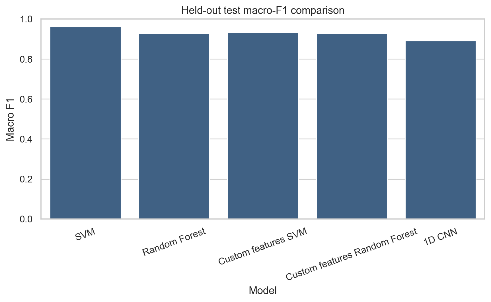
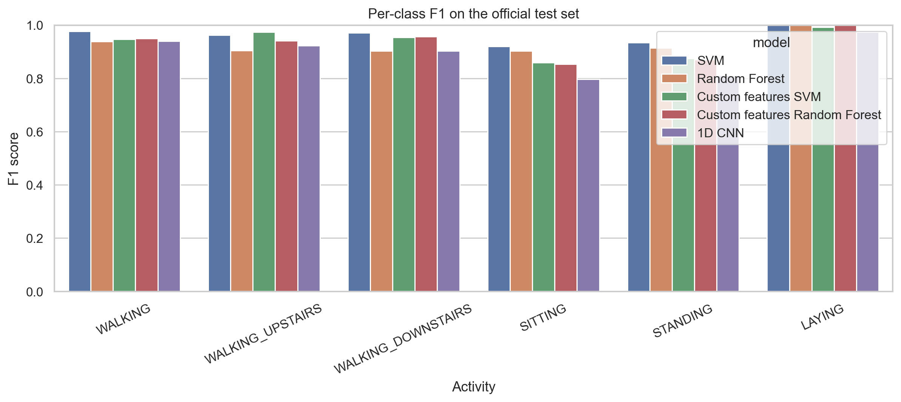
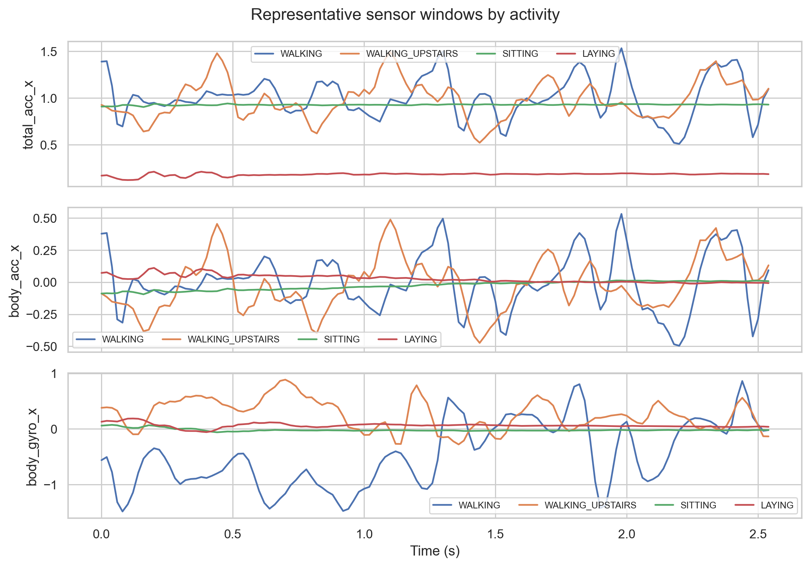
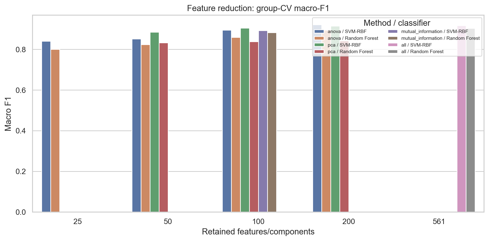
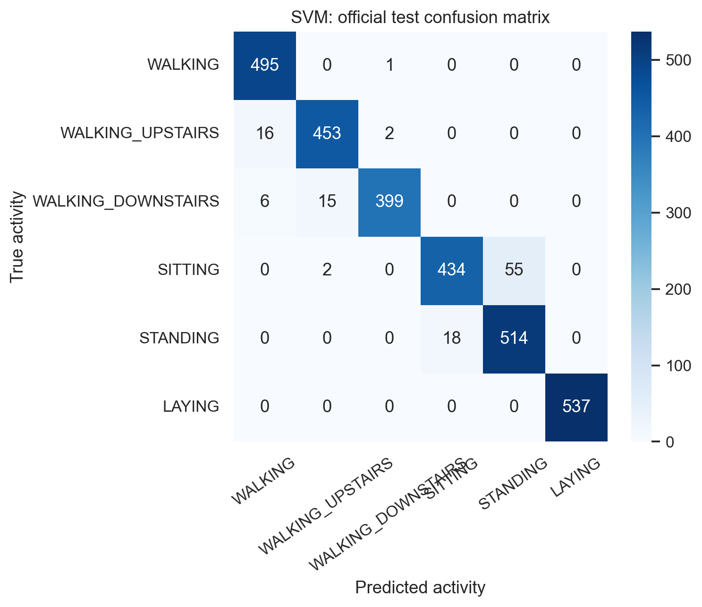
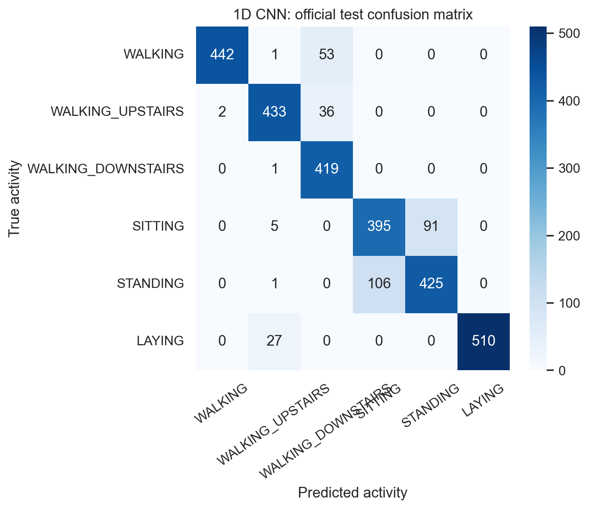

# Smartphone-Based Human Activity Recognition
### A Comparison of SVM, Random Forest and 1D CNN


This repository contains the code, configuration and results for our paper **Smartphone-Based Human Activity Recognition: A Comparison of SVM, Random Forest and 1D CNN**. We compare a hand-crafted-feature **SVM** and **Random Forest** against a **1D CNN** trained on raw inertial signals from the UCI HAR dataset. Every model is evaluated **subject-independently**: the 9 test participants are never used for training, tuning, feature selection or early stopping.

> **Key finding:** On this small benchmark, careful feature engineering still beats a lightly tuned deep model. The linear SVM reaches **96.10% accuracy / 0.9608 macro-F1** on unseen people, while the 1D CNN reaches 0.8912.

**Authors:** Aarya Yadav, Sidharth Vijayan, Shankhadeep Mandal, Anita Gunjal
Department of Computer Engineering and Technology, Dr. Vishwanath Karad MIT World Peace University, Pune

---

## Contents

- [Results at a glance](#results-at-a-glance)
- [Dataset](#dataset)
- [Methodology](#methodology)
- [Feature selection and PCA](#feature-selection-and-pca)
- [Error analysis](#error-analysis)
- [Quick start](#quick-start)
- [Repository structure](#repository-structure)
- [Limitations and future work](#limitations-and-future-work)
- [References](#references)

---

## Results at a glance

Official test set: 9 unseen participants, 2,947 windows. Macro-F1 is the primary metric because it weights all six activities equally.

| Input | Model | Accuracy | Macro-F1 | Weighted F1 | Fit (s) | Predict (s) |
|---|---|---:|---:|---:|---:|---:|
| Official 561-D | **Linear SVM** | **0.9610** | **0.9608** | **0.9609** | 0.88 | 0.29 |
| Official 561-D | Random Forest | 0.9291 | 0.9271 | 0.9288 | 7.06 | **0.05** |
| Custom 228-D | SVM | 0.9332 | 0.9337 | 0.9330 | 0.56 | 0.81 |
| Custom 228-D | Random Forest | 0.9284 | 0.9287 | 0.9283 | 5.22 | 0.06 |
| Raw 128×9 | 1D CNN | 0.8904 | 0.8912 | 0.8910 | 18.10 | 0.20 |

<p align="center">
  
  
</p>

**Highlights**
- The **linear SVM** wins overall. It is also the fastest model to train on the official features.
- The **Random Forest** is the fastest at prediction: all 2,947 test windows in about 0.05 s.
- Our own **228 features** match the 561 official ones for the Random Forest (0.9287 vs. 0.9271) and cost the SVM only 0.027 macro-F1.
- **ANOVA top-200 selection** slightly *improves* cross-validated SVM performance (0.9223 vs. 0.9168) and cuts fit time about 4×.
- **Sitting vs. standing** is the hardest pair for every model.
- SVM per-subject test accuracy ranges from 91.8% (subject 10) to 99.1% (subject 13).

---

## Dataset

[UCI Human Activity Recognition Using Smartphones](https://archive.ics.uci.edu/dataset/240/human+activity+recognition+using+smartphones) (Reyes-Ortiz et al., 2013).

| Property | Value |
|---|---|
| Participants | 30 volunteers, aged 19–48 |
| Device | Samsung Galaxy S II, worn on the waist |
| Sensors | Accelerometer and gyroscope at 50 Hz |
| Window | 2.56 s (128 samples), 50% overlap |
| Raw channels | 9 (total acc, body acc, body gyro × x/y/z) |
| Official features | 561 time- and frequency-domain features |
| Train / Test | 7,352 windows (21 people) / 2,947 windows (9 people), participant-disjoint |
| Classes | WALKING, WALKING_UPSTAIRS, WALKING_DOWNSTAIRS, SITTING, STANDING, LAYING |

The loader downloads the dataset automatically. It checks that train and test participants are disjoint, that all values are finite, and that labels and subject IDs line up with the signal files. For offline use, see [data/README.md](data/README.md). The dataset files are not committed to the repository.

<p align="center">
  
</p>

---

## Methodology

### Validation protocol (no subject leakage)
Neighbouring windows overlap and come from the same person, so a random split would leak information. Instead:
- `StratifiedGroupKFold` (3 folds) uses the **participant ID as the group**.
- Scalers, selectors and PCA are fitted **inside each training fold only**.
- Hyperparameters are chosen by mean macro-F1 across the folds.
- The final model is refit on all 21 training participants and evaluated **once** on the 9 test participants.
- The random seed is fixed at 42.

### Feature representations
| Representation | Description |
|---|---|
| **Official (561-D)** | Time- and frequency-domain features that ship with the dataset |
| **Custom (228-D)** | Our own features per axis: mean, variance, RMS, min/max, median, IQR, mean absolute value, energy, skewness, kurtosis and zero-crossing rate. Plus axis correlations, magnitude statistics and FFT features: dominant frequency, total power, spectral centroid, spectral entropy and 4 band energies |
| **Raw (128 × 9)** | Raw signal windows fed straight to the CNN |

### Models
| Model | Details | Selected configuration |
|---|---|---|
| **SVM** | `StandardScaler` + `SVC`; linear/RBF kernel, C ∈ {1, 10} | Linear, C = 1 (CV macro-F1 0.9172) |
| **Random Forest** | Search over number of trees, depth, minimum leaf size and `max_features`; class weights `balanced_subsample` | 160 trees, unlimited depth, min leaf 2, √d features (CV macro-F1 0.9057) |
| **1D CNN** (PyTorch) | 3 conv blocks (32/64/96 filters, kernels 7/5/3) with BatchNorm + ReLU, max-pool ×2, global average pooling, dropout 0.35, linear layer to 6 classes. Adam (lr 1e-3, weight decay 1e-4), batch size 128 | Validation on 4 held-out training participants (IDs 5, 7, 22, 25); early stopping on validation macro-F1 |

---

## Feature selection and PCA

Grouped 3-fold CV macro-F1 on the training participants:

| Method | Dims | RBF SVM | Random Forest | SVM fit (s) |
|---|---:|---:|---:|---:|
| All features | 561 | 0.9168 | **0.9044** | 5.89 |
| ANOVA | 25 | 0.8403 | 0.8006 | 1.72 |
| ANOVA | 50 | 0.8518 | 0.8243 | 1.40 |
| ANOVA | 100 | 0.8954 | 0.8594 | 1.20 |
| **ANOVA** | **200** | **0.9223** | 0.8948 | 1.27 |
| Mutual information | 100 | 0.8933 | 0.8830 | 26.07 |
| PCA | 50 | 0.8846 | 0.8331 | 1.73 |
| PCA | 100 | 0.9051 | 0.8379 | 2.47 |
| PCA | 200 | 0.9153 | 0.8425 | 3.81 |

- **ANOVA-200** is the best setting for the SVM and is about 4× faster to fit than using all features.
- **PCA** works for the SVM but hurts the Random Forest. Trees split on one variable at a time, and PCA mixes information across components.
- **Mutual information** gives competitive scores but is by far the slowest method, at about 26 s per fold.

<p align="center">
  
</p>

---

## Error analysis

<p align="center">
  
  
</p>

- **LAYING** is essentially solved by the classical models (F1 = 1.000), because phone orientation changes completely when lying down.
- **SITTING ↔ STANDING** is the main error source for every model: SVM 55 + 18 errors, RF 55 + 38, CNN 91 + 106.
- **Upstairs ↔ downstairs**: the RF mislabels 45 downstairs windows as upstairs, versus 15 for the SVM.
- **CNN overfitting**: the CNN peaks at 0.9631 validation macro-F1 after one epoch but scores only 0.8912 on test. Four validation participants are too few to give a stable estimate.
- **Feature importance**: gravity-orientation features (`tGravityAcc-min()-Y`, `tGravityAcc-mean()-Y` and `angle(Y,gravityMean)`) rank highest for the Random Forest.

---

## Quick start

Requires Python 3.10+.

```bash
git clone https://github.com/Aarya2304/Pattern-Recognition-Project.git
cd Pattern-Recognition-Project
python -m venv .venv
source .venv/bin/activate        # Windows: .venv\Scripts\activate
pip install -r requirements.txt
```

| Command | What it does |
|---|---|
| `python main.py --mode validate` | Download and validate the dataset, then print its shapes and participant splits |
| `python main.py` | Run the full experiment pipeline |
| `python main.py --mode smoke` | Run a quick reduced check (results are not final) |
| `python main.py --stage <name>` | Run one resumable stage: `baselines`, `features`, `representations`, `cnn`, `finish` |
| `python -m pytest -q` | Run the unit tests |

Options: `--data-dir` (default `data`) and `--results-dir` (default `results`). Run `--stage finish` only after the model stages have completed, because it consolidates their saved outputs. Experiment defaults live in [configs/experiment_config.yaml](configs/experiment_config.yaml).

---

## Repository structure

```text
├── configs/experiment_config.yaml   Seed, CV, model grids, CNN hyperparameters
├── src/
│   ├── data_loader.py               Download, parse and validate UCI HAR
│   ├── feature_engineering.py       Custom 228-D statistical and spectral features
│   ├── feature_selection.py         ANOVA, mutual information and PCA experiments
│   ├── models.py                    SVM / Random Forest pipelines, 1D CNN
│   ├── training.py                  Subject-aware CNN training and occlusion importance
│   ├── evaluation.py                Grouped splits, tuning, metrics and timings
│   ├── visualization.py             All figures
│   └── experiments.py               End-to-end orchestration
├── tests/                           Unit tests
├── results/
│   ├── figures/                     Plots (signals, PCA, confusion matrices, ...)
│   ├── metrics/                     CSV/JSON metrics, CV searches, reports
│   ├── models/                      Fitted pipelines (.joblib) and CNN checkpoint (.pt)
│   └── predictions/                 Per-window test predictions
├── docs/                            Report, methodology, theory, results, limitations
└── main.py                          CLI entry point
```

Detailed write-ups: [project report](docs/project_report.md) · [methodology](docs/methodology.md) · [theoretical background](docs/theoretical_background.md) · [experimental results](docs/experimental_results.md) · [limitations](docs/limitations.md)

---

## Limitations and future work

- UCI HAR is small: 30 people performing scripted activities with the same phone in the same position. With only 9 test people, the results carry real uncertainty.
- The hyperparameter grids are small. The CNN is deliberately compact and was trained on a CPU with a short budget.
- Timings come from one CPU and do not reflect on-device latency.

**Next steps:** repeated nested subject-wise CV, data from other phones and body positions, a stronger CNN with augmentation and recurrent layers, and evaluation on real, unscripted daily activity.

---

## References

1. J. Reyes-Ortiz, D. Anguita, A. Ghio, L. Oneto, X. Parra. *Human Activity Recognition Using Smartphones.* UCI ML Repository, 2013. [doi:10.24432/C54S4K](https://doi.org/10.24432/C54S4K)
2. D. Anguita et al. *A public domain dataset for human activity recognition using smartphones.* ESANN, 2013.
3. C. Cortes, V. Vapnik. *Support-vector networks.* Machine Learning, 1995. [doi:10.1007/BF00994018](https://doi.org/10.1007/BF00994018)
4. L. Breiman. *Random forests.* Machine Learning, 2001. [doi:10.1023/A:1010933404324](https://doi.org/10.1023/A:1010933404324)
5. C. A. Ronao, S.-B. Cho. *Human activity recognition with smartphone sensors using deep learning neural networks.* Expert Systems with Applications, 2016.
6. N. Y. Hammerla, S. Halloran, T. Plötz. *Deep, convolutional, and recurrent models for human activity recognition using wearables.* IJCAI, 2016.

The full reference list is in the paper and in [docs/project_report.md](docs/project_report.md).
