# Advanced Human Activity Recognition Using Multimodal Smartphone Sensor Data

## Comparative Pattern Recognition, Signal Processing, Feature Engineering, and Deep Learning

**Student name:** [Editable field]  
**Roll number:** [Editable field]  
**Institution:** [Editable field]  
**Project guide:** [Editable field]  
**Submission date:** [Editable field]

---

## Abstract

This project evaluates six-class human activity recognition (HAR) from the UCI Human Activity Recognition Using Smartphones benchmark. The official archive was inspected and validated as 7,352 training and 2,947 test windows, 561 engineered features per window and nine aligned inertial channels of 128 samples at 50 Hz. The official 21/9-participant train/test split is participant-disjoint. Linear and RBF support vector machines (SVMs), a Random Forest, two classifiers over newly extracted statistical/spectral window descriptors, and a compact one-dimensional convolutional neural network (CNN) were evaluated. Classical hyperparameter selection used participant-grouped cross-validation inside training data; feature selection and PCA were similarly evaluated within fold-local pipelines. On the official test partition, the selected linear SVM achieved accuracy 0.9610 and macro-F1 0.9608; the Random Forest achieved 0.9291 and 0.9271; the raw-signal CNN achieved 0.8904 and 0.8912. The custom statistical/spectral SVM achieved macro-F1 0.9337. In grouped training CV, a 200-feature ANOVA-selected RBF SVM yielded macro-F1 0.9223 versus 0.9168 with all 561 features. Results illustrate that representation and model choice materially affect predictive quality and runtime; the tested CNN did not surpass engineered-feature classifiers. Metrics, figures, predictions, and fitted models are provided under `../results/`. The full selector comparison includes both SVM and Random Forest under the available grouped folds and a bounded candidate grid.

## 1. Introduction

Smartphones carry accelerometers and gyroscopes that capture motion continuously. Mapping short sensor windows to activity labels is a supervised pattern-recognition problem relevant to context-aware systems and activity monitoring. Inertial signals are multivariate and temporally structured; discriminating dynamic locomotion from static postures requires useful signal representation and evaluation across people rather than only across correlated windows.

### 1.1 Background and motivation

An activity classifier may consume engineered time/frequency summaries, directly computed descriptors, or raw multichannel time-series. Classical models can exploit compact hand-designed features with limited training cost. A convolutional network can learn local temporal filters, but needs adequate training and subject-aware validation. Comparing these representations under an official participant-held-out test set supports a more meaningful assessment of generalization.

### 1.2 Problem statement

Given a segmented inertial sensor window, predict one of WALKING, WALKING_UPSTAIRS, WALKING_DOWNSTAIRS, SITTING, STANDING, or LAYING. The principal challenge is achieving robust class recognition for participants not used for fitting while controlling leakage through overlapping windows and preprocessing.

### 1.3 Objectives and scope

The project implements linear/RBF SVMs, a Random Forest and a 1D CNN; statistical and spectral feature extraction; grouped validation; ANOVA, mutual-information and PCA experiments; test-set metrics, interpretability and error analysis. Scope is restricted to the original six-class UCI HAR dataset and its two supplied partitions. No online deployment or external sensor evaluation is claimed.

## 2. Dataset and exploratory analysis

The source is the [UCI Machine Learning Repository, Human Activity Recognition Using Smartphones, dataset 240](https://archive.ics.uci.edu/dataset/240/human+activity+recognition+using+smartphones). The archive README states that 30 volunteers (19–48 years) performed six activities with a waist-mounted Samsung Galaxy S II. Sensors sampled at 50 Hz; signals were filtered and segmented into 2.56-second windows of 128 readings with 50% overlap. The supplied data include total acceleration, body acceleration, body gyroscope, labels, participants and 561 features. Total acceleration axes are measured in g and gyroscope axes in rad/s per the README.

The loader validated 7,352 training windows and 2,947 test windows, each with 561 values; the nine signal channels are ordered as total acceleration x/y/z, body acceleration x/y/z, and body gyroscope x/y/z. Each signal array has shape (windows, 128, 9). Train participant IDs comprise 21 people; test IDs comprise nine different people. No non-finite values or invalid activity IDs were found. Figure 1 shows training class counts and Figure 2 participant window counts. Figures 3 and 4 display representative measured windows and single-sided FFT magnitude spectra. Figure 5 shows selected feature distributions; Figure 6 shows correlations among the first 30 listed engineered features.

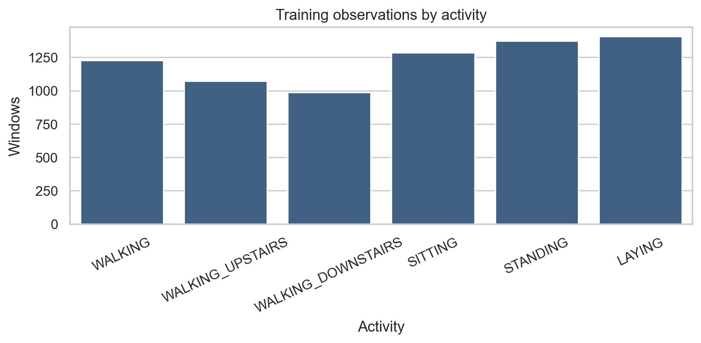

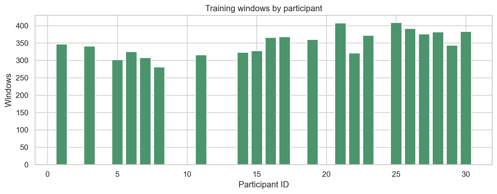

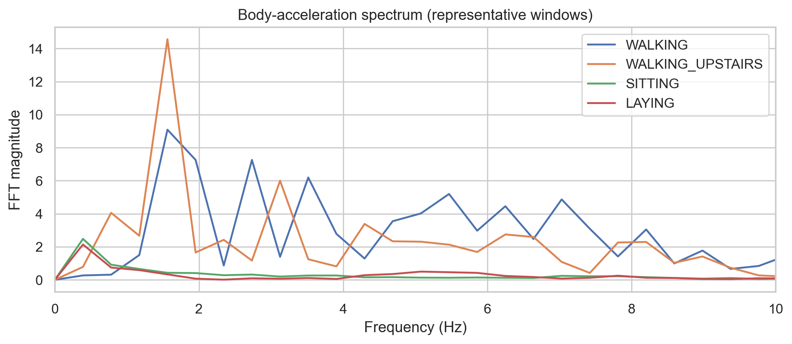

## 3. Theoretical foundations

### 3.1 Statistical and spectral descriptors

For samples \(x_t\), the mean is \(\bar{x}=N^{-1}\sum_t x_t\); variance is \(N^{-1}\sum_t(x_t-\bar{x})^2\); RMS is \(\sqrt{N^{-1}\sum_t x_t^2}\); and IQR is \(Q_{.75}-Q_{.25}\). The implementation adds min, max, median, mean absolute value, normalized energy, skewness, excess kurtosis, zero-crossing rate, per-window axis correlations and signal-magnitude summaries.

The DFT is \(X_k=\sum_nx_ne^{-j2\pi kn/N}\). With \(P_k=|X_k/N|^2\), spectral centroid is \(\sum_k f_kP_k/\sum_kP_k\), entropy is \(-\sum_kp_k\log_2p_k\), where \(p_k=P_k/\sum_jP_j\), and dominant frequency is the strongest non-DC bin. Four frequency-band energies complete the custom per-axis descriptor.

### 3.2 Support Vector Machine

A soft-margin SVM minimizes \(\frac12\|w\|^2+C\sum_i\xi_i\), subject to margin constraints \(y_i(w^Tx_i+b)\ge1-\xi_i\). Observations constraining the margin are support vectors. Linear and RBF kernels are tested; \(K(x,z)=e^{-\gamma\|x-z\|^2}\) enables nonlinear boundaries. Standardization is necessary for scale-sensitive distances and margins and is included within the training pipeline. C controls regularization strength.

### 3.3 Random Forest

A forest aggregates decision trees fitted on bootstrap samples, with random candidate features at each split. Each tree partitions the feature space by impurity reduction; classification uses majority voting. Ensemble averaging reduces variance. Impurity importance can be biased and divides importance among correlated variables, so a group-held-out permutation analysis is also reported.

### 3.4 Feature selection and PCA

Mutual information estimates dependence between an individual feature and class. ANOVA F scores measure between-class relative to within-class variation. Selectors rank original named features. PCA instead computes orthogonal linear combinations maximizing variance after standardization: the retained components are mixtures and are not necessarily the most discriminative. Both transforms are fit inside training folds in CV. Figure 7 plots cumulative PCA variance, Figure 8 its first two components, and Figure 9 top training mutual-information scores.

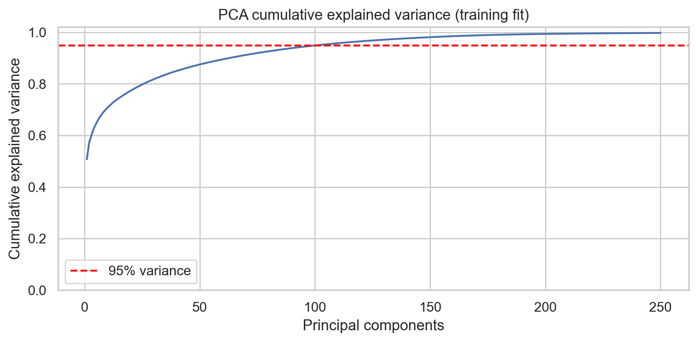

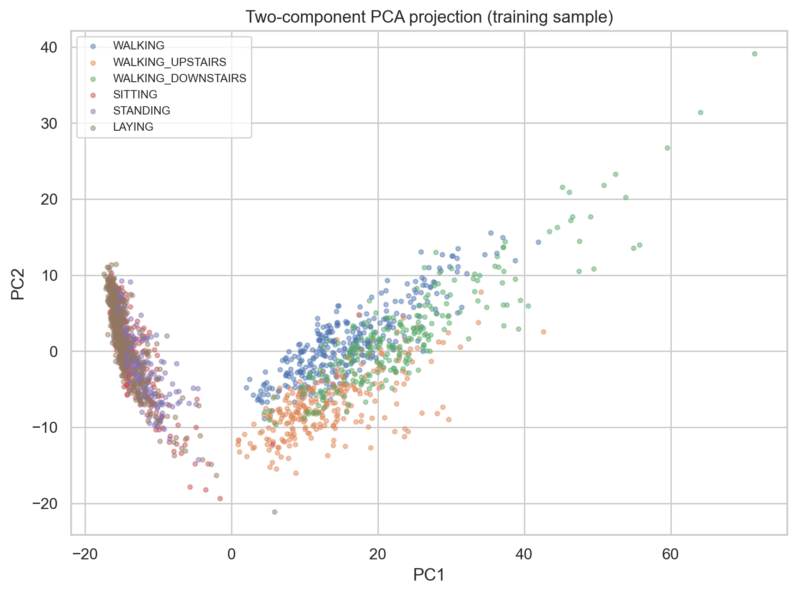

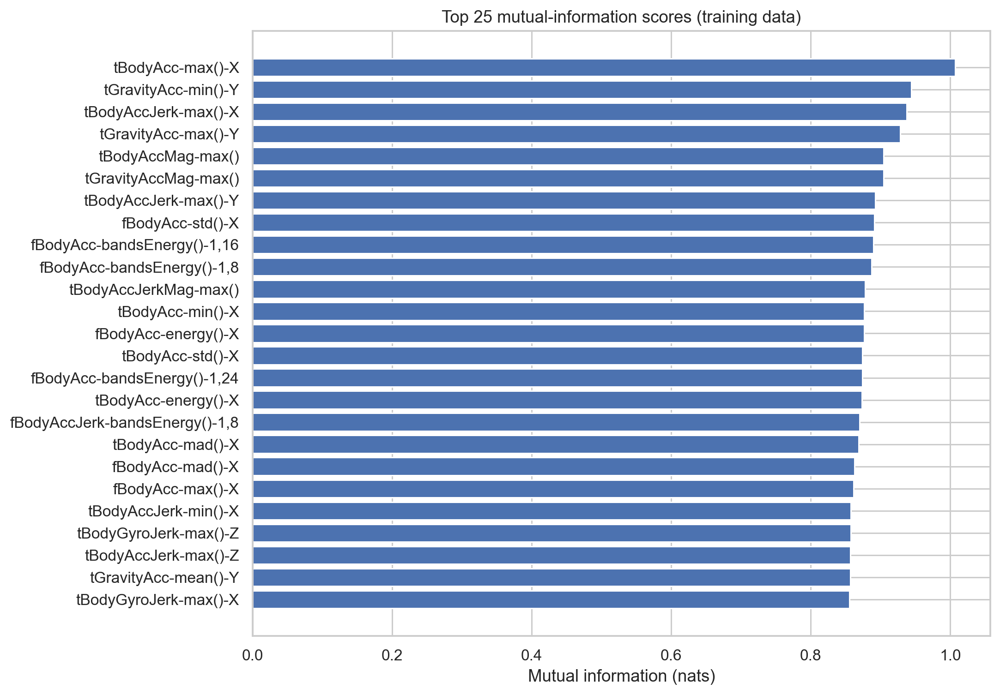

### 3.5 One-dimensional CNN

A temporal convolution computes local weighted sums shared over time. ReLU introduces nonlinearity, batch normalization stabilizes activations, and max pooling reduces temporal resolution. The implemented model has three Conv1d blocks (32, 64 and 96 channels), batch normalization/ReLU, two max-pooling layers, global average pooling, dropout 0.35 and a six-logit output. Cross-entropy is optimized with Adam and weight decay. Validation macro-F1 drives early stopping and checkpoint selection. Channel normalization parameters are estimated only on CNN fit-participant windows.

## 4. Signal processing and feature engineering

UCI distributes already filtered windows and engineered features; this work inspects their nine available axes and computes an independent per-window representation rather than reconstructing unavailable continuous sensor recordings. Per-axis statistical descriptors cover the temporal distribution, magnitude and crossings; pairwise correlations quantify same-window axis relationships. FFT summaries characterize periodic spectral content. Figure 4 presents representative spectra only, and should not be interpreted as an aggregate significance analysis.

The original 561-feature representation is retained as the main classical input. The new 228-column representation is computed independently from each of the nine axes (statistics, correlations and frequency features) and modelled with SVM and forest. The CNN consumes (128, 9) windows and learns its representation from samples.

## 5. Experimental design and leakage prevention

The official test partition remains held out for final evaluation. The official participant sets are disjoint, so this test estimates generalization to unseen participants. Within the 21 training participants, StratifiedGroupKFold ensures participant IDs do not overlap between each fit and validation fold. Classical hyperparameters are selected using mean macro-F1 over three group folds. Feature scaling, ANOVA, MI selection and PCA are fit within the fold. The CNN uses a whole-participant validation partition from official training and fits per-channel normalization on the remaining training subjects. The CNN epoch is chosen by validation macro-F1; no official test data drive selection. The fixed random seed is 42. Details are in [`methodology.md`](methodology.md).

## 6. System architecture and implementation

`src/data_loader.py` downloads the official UCI archive (including its nested ZIP format), safely extracts it and validates names, dimensions, labels, participants and alignment. `src/feature_engineering.py` computes the 228 custom descriptors. `src/feature_selection.py` executes grouped fold-local reduction experiments. `src/models.py`, `src/training.py` and `src/experiments.py` implement model definitions, tuning, training and evaluation. `src/evaluation.py` writes metrics and reports; `src/visualization.py` generates the measured plots. NumPy, SciPy, pandas, scikit-learn, matplotlib, seaborn, joblib, PyTorch and pytest are listed in `requirements.txt`. Saved fitted classical estimators use joblib; the CNN stores its state dict, normalization and training metadata.

## 7. Evaluation metrics

For each activity, precision is \(TP/(TP+FP)\), recall is \(TP/(TP+FN)\), and F1 is their harmonic mean. Macro metrics average across six activities equally; weighted F1 accounts for class support. Accuracy is the proportion correctly classified. Confusion matrices use the fixed official activity order. Fit time and full test inference wall time are measured in the current CPU environment. Timing is hardware and batch dependent.

## 8. Results

### 8.1 Held-out test comparison

**Table 1. Official test metrics and measured runtimes.**

| Model and representation | Accuracy | Macro precision | Macro recall | Macro F1 | Weighted F1 | Fit (s) | Predict test (s) |
|---|---:|---:|---:|---:|---:|---:|---:|
| Linear SVM, official 561 | 0.9610 | 0.9629 | 0.9600 | **0.9608** | 0.9609 | 2.770 | 0.930 |
| Random Forest, official 561 | 0.9291 | 0.9302 | 0.9259 | 0.9271 | 0.9288 | 13.484 | 0.160 |
| 1D CNN, raw 9-channel | 0.8904 | 0.8929 | 0.8935 | 0.8912 | 0.8910 | 59.359 | 0.396 |
| SVM, custom descriptors | 0.9332 | 0.9338 | 0.9339 | 0.9337 | 0.9330 | 1.969 | 2.916 |
| Random Forest, custom descriptors | 0.9284 | 0.9299 | 0.9281 | 0.9287 | 0.9283 | 9.579 | 0.201 |

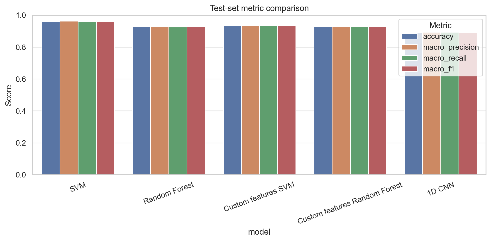

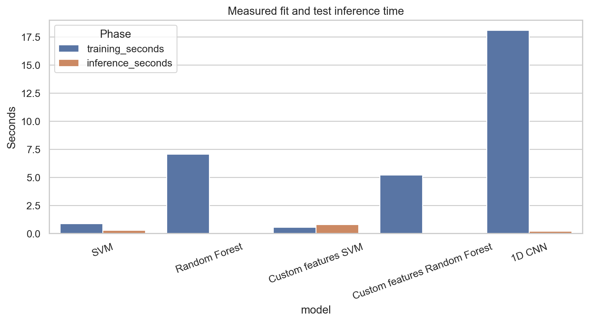

The linear SVM with official features was strongest on all reported macro averages in this run. The tested CNN did not exceed classical engineered representations. The Random Forest has lower measured prediction time than the SVM, with a smaller test macro-F1. The custom SVM is 0.0272 macro-F1 below the official-feature SVM but exceeds the Random Forest in this run. These differences describe the saved held-out run, not a universal model ranking.

### 8.2 Grouped validation and hyperparameter selection

**Table 2. Selected configuration performance in training-only participant-group CV.**

| Family | Selected configuration | Mean macro-F1 | Fold SD |
|---|---|---:|---:|
| SVM | Linear, C=1 | 0.9172 | 0.0143 |
| Random Forest | 160 trees, unrestricted depth, leaf=2, sqrt features | 0.9057 | 0.0141 |

The compared SVM candidates were linear and RBF with C=1 or 10. Forest candidates varied estimator count (120–200), depth, minimum leaf size and `max_features`. Full candidate metrics appear in `../results/metrics/group_cv_hyperparameter_search.csv`. The final CV estimates differ from the official-test scores and are not paired confidence intervals.

### 8.3 Feature selection and PCA

**Table 3. Grouped training CV for evaluated feature sets (SVM RBF and Random Forest).**

| Method | Features/components | Mean macro-F1 | Fold SD | Mean fold fit time (s) |
|---|---:|---:|---:|---:|
| All features | 561 | 0.9168 | 0.0101 | 5.894 |
| ANOVA | 25 | 0.8403 | 0.0364 | 1.715 |
| ANOVA | 50 | 0.8518 | 0.0557 | 1.402 |
| ANOVA | 100 | 0.8954 | 0.0225 | 1.204 |
| ANOVA | 200 | **0.9223** | 0.0152 | 1.268 |
| Mutual information | 100 | 0.8933 | 0.0139 | 26.068 |
| PCA | 50 | 0.8846 | 0.0145 | 1.733 |
| PCA | 100 | 0.9051 | 0.0163 | 2.470 |
| PCA | 200 | 0.9153 | 0.0092 | 3.805 |

Random Forest selector scores were 0.9044 (all 561), 0.8006/0.8243/0.8594/0.8948 (ANOVA 25/50/100/200), 0.8830 (MI-100), and 0.8331/0.8379/0.8425 (PCA 50/100/200). Their fold standard deviations and times are recorded in `../results/metrics/feature_selection_group_cv.csv`.

| Method | Features/components | Forest macro-F1 | Forest fold SD | Forest mean fit time (s) |
|---|---:|---:|---:|---:|
| All features | 561 | 0.9044 | 0.0157 | 4.759 |
| ANOVA | 25 | 0.8006 | 0.0277 | 1.394 |
| ANOVA | 50 | 0.8243 | 0.0354 | 1.730 |
| ANOVA | 100 | 0.8594 | 0.0385 | 2.227 |
| ANOVA | 200 | 0.8948 | 0.0192 | 2.836 |
| Mutual information | 100 | 0.8830 | 0.0256 | 27.172 |
| PCA | 50 | 0.8331 | 0.0290 | 2.406 |
| PCA | 100 | 0.8379 | 0.0338 | 3.641 |
| PCA | 200 | 0.8425 | 0.0336 | 5.663 |

ANOVA with 200 original variables exceeds the all-feature RBF CV score by about 0.0055 absolute macro-F1 and has lower mean fold fit time in this run (1.268 s versus 5.894 s per fold). At 25 or 50 features, performance is poorer, indicating that retaining too few features discards useful information. PCA at 200 components comes within 0.0015 of the all-feature result while representing data in 200 mixed directions. MI-100 scored 0.8933, about 0.0236 below the all-feature SVM, and by far the largest fit time (26.1 s per fold) because mutual information is recomputed inside every training fold. The completed full selector grid includes both SVM and Random Forest. For the forest, all 561 features scored 0.9044; ANOVA-200 scored 0.8948; MI-100 scored 0.8830; and PCA-200 scored 0.8425. Figure 10 displays both classifier families. For the forest, none of the tested reduced representations exceeded all features (0.9044); the full scores and times are in `feature_selection_group_cv.csv`. The plotted cumulative PCA curve is based on a 250-component training-fitted PCA; the CSV records the component variance ratios.

### 8.4 Per-class errors and interpretability

**Table 4. Per-class F1 on the official test partition.**

| Activity | SVM | Random Forest | 1D CNN |
|---|---:|---:|---:|
| WALKING | 0.9773 | 0.9377 | 0.9404 |
| WALKING_UPSTAIRS | 0.9628 | 0.9049 | 0.9223 |
| WALKING_DOWNSTAIRS | 0.9708 | 0.9024 | 0.9030 |
| SITTING | 0.9205 | 0.9036 | 0.7964 |
| STANDING | 0.9337 | 0.9140 | 0.8111 |
| LAYING | 1.0000 | 1.0000 | 0.9742 |

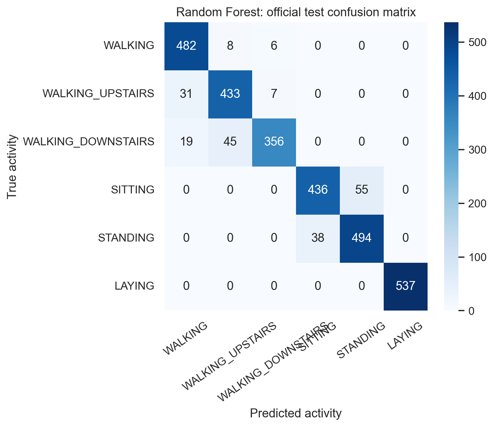

The CNN’s lowest class F1 values are SITTING (0.7964) and STANDING (0.8111); its dynamic-class F1 values are higher. LAYING is strongest across these models. These error patterns are descriptive of the official test predictions. Figure 21 aggregates common off-diagonal errors. Forest impurity rankings and training-fold top-40 MI-restricted permutation values are in `../results/metrics/feature_importance.csv`; rankings are not causal explanations. CNN occlusion is computed on validation participants and is stored in `cnn_occlusion_importance.csv`. Figure 20 displays forest importance.

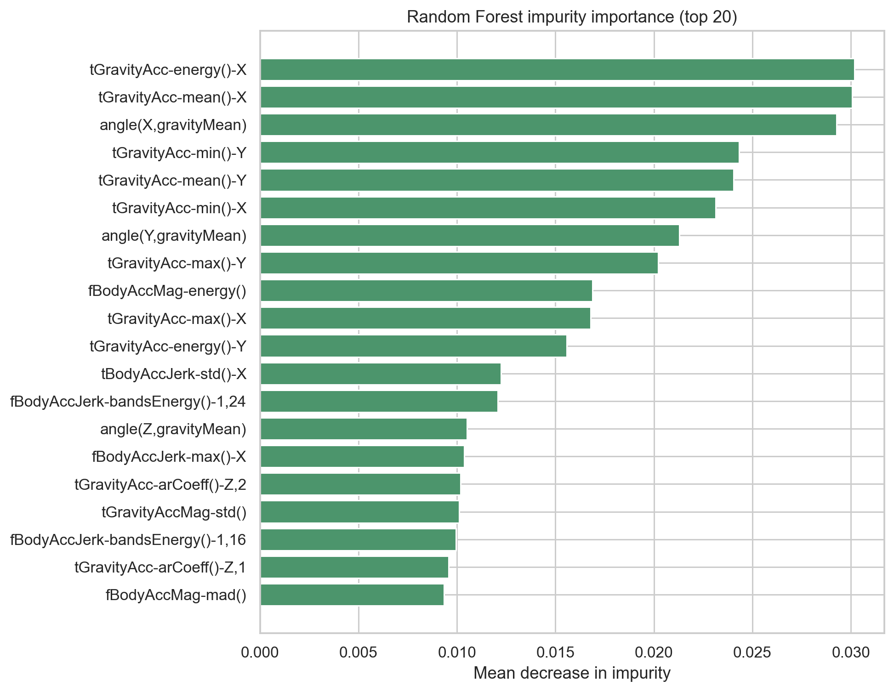

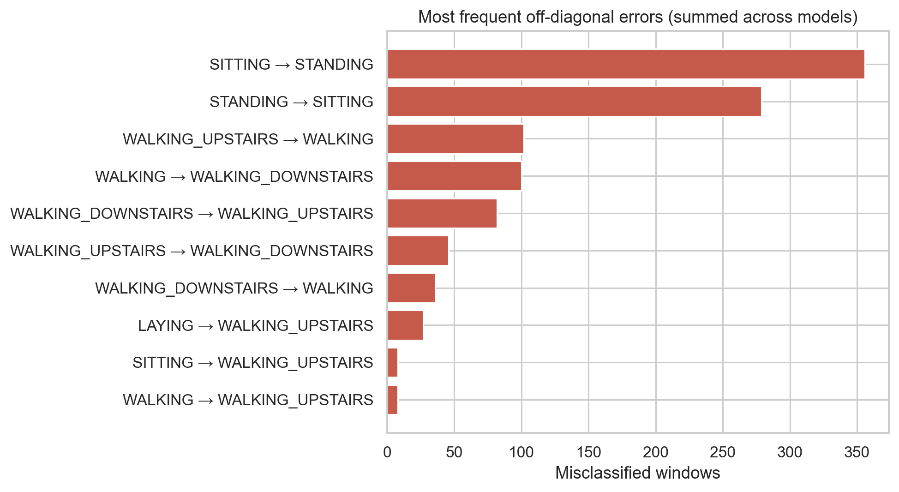

### 8.5 CNN learning and generalization

The CNN’s best checkpoint was epoch 1 under participant-held-out validation macro-F1 0.9631, from 17 fit and four validation participants. Training stopped after epoch 10 under a nine-epoch patience setting; the best checkpoint was preserved. Its official test macro-F1 is 0.8912, notably below training-partition validation performance. This difference signals limited cross-subject stability for the particular split/model/training run and warrants caution; it is not used to retune the model against the official test.

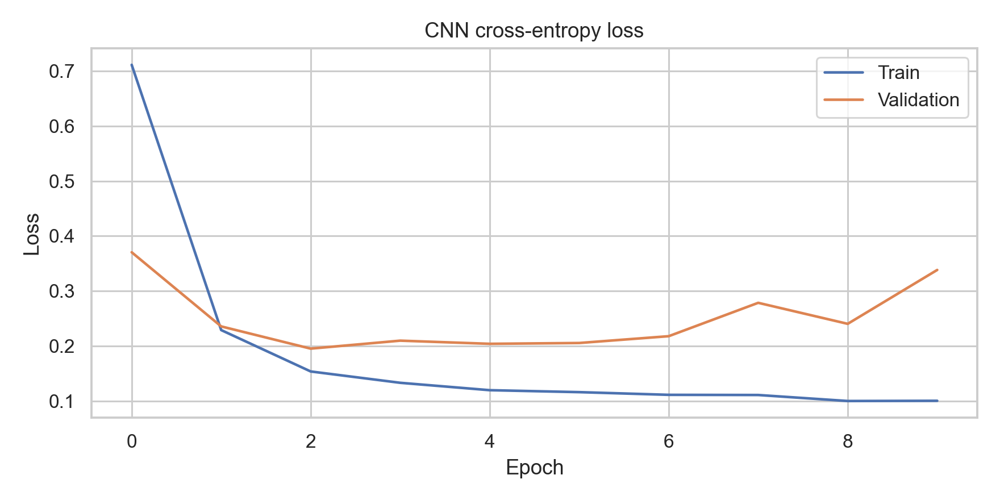

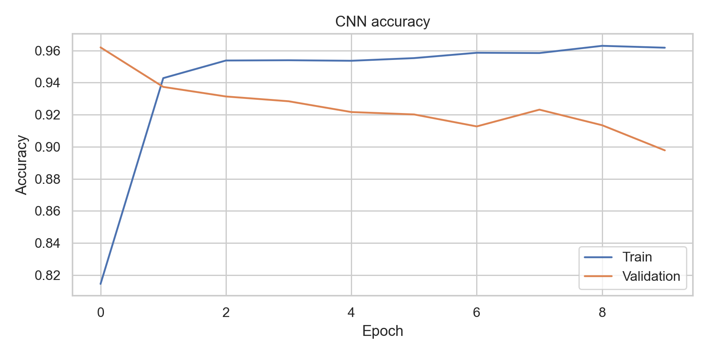

## 9. Research questions and discussion

1. **SVM, forest and CNN:** The linear SVM on supplied features had the best test macro-F1 (0.9608); the forest had faster test prediction, and the CNN reached 0.8912. This shows that learned temporal representations did not automatically outperform the benchmark's extensive feature engineering under the chosen CPU training budget.
2. **Feature selection:** ANOVA's 200-feature set increased grouped CV macro-F1 over all-feature RBF SVM and reduced measured fold-fit time. Smaller sets degraded score. MI's 100 features were close to all features, though ranking took longer.
3. **PCA:** At 200 components, PCA nearly matched the 561-feature RBF score (0.9153 vs 0.9168) with fewer dimensions; for the forest, the 200-component score was lower than all features (0.8425 vs 0.9044). No claim is made that it improves discrimination. PCA components are not individually interpretable named sensors/features.
4. **Informative features:** MI scores and forest impurity/permutation ranking files identify variables by measured association or validation score loss. These rankings can differ because their estimands differ and correlated variables share importance. Figure 9 and the CSVs provide exact rankings rather than claiming one universally causal feature.
5. **Unseen participants:** The official test is participant-disjoint, and grouped CV is participant-aware. The selected SVM CV macro-F1 was 0.9172 and official test macro-F1 0.9608; forest values were 0.9057 and 0.9271. The CNN's single validation split was 0.9631 versus 0.8912 official test, motivating caution about stability.
6. **Confusions:** SITTING and STANDING are the weakest CNN classes (F1 0.7964 and 0.8111); confusion matrices identify the observed pairs. No unsupported cause is inferred.
7. **Representation:** Custom feature SVM macro-F1 (0.9337) was below original SVM (0.9608); CNN raw-signal macro-F1 was 0.8912. In this configuration, supplied features retain useful information and provide strong performance with less fit time.
8. **Trade-offs:** The SVM prioritizes accuracy and modest fit time, the forest has very short measured inference and accessible feature rankings, and the CNN offers learned temporal features but longer fit/inference and lower test F1 here. Timing reflects this CPU host and batching only.

## 10. Limitations and threats to validity

The dataset is small, scripted and collected from a waist-mounted handset and 30 volunteers; it does not establish free-living, cross-device or clinical validity. Overlapping windows are correlated, although group-aware folds and official participant separation prevent subject overlap across evaluations. The official test has only nine participants. Model searches and selector grids are finite and not exhaustive. CNN architecture, early stopping and CPU resource budget are not exhaustive. Permutation and occlusion diagnostics are limited and not causal. Additional limitations are documented in [`limitations.md`](limitations.md).

## 11. Conclusion and future scope

For this implemented protocol, the original-feature linear SVM gave the highest measured official-test performance, while the forest offered rapid inference and the compact raw-signal CNN did not match the feature-based models. Grouped feature experiments showed that ANOVA-selected 200 features can retain or improve RBF SVM CV performance relative to all features; PCA with 200 components was close to the all-feature score. These are results on one official benchmark split, not guarantees of wider population performance. Future work could use repeated nested participant-group validation, broader sensor populations and phone placements, stronger CNN regularization/augmentation, and cross-device external evaluation without using the current test set for tuning.

## References

1. Reyes-Ortiz, J., Anguita, D., Ghio, A., Oneto, L., & Parra, X. (2013). *Human Activity Recognition Using Smartphones* [Dataset]. UCI Machine Learning Repository. https://doi.org/10.24432/C54S4K. https://archive.ics.uci.edu/dataset/240/human+activity+recognition+using+smartphones
2. Anguita, D., Ghio, A., Oneto, L., Parra, X., & Reyes-Ortiz, J. L. (2013). A public domain dataset for human activity recognition using smartphones. *ESANN 2013 Proceedings*, 437–442. https://www.esann.org/sites/default/files/proceedings/legacy/es2013-84.pdf
3. Cortes, C., & Vapnik, V. (1995). Support-vector networks. *Machine Learning, 20*(3), 273–297. https://doi.org/10.1007/BF00994018
4. Breiman, L. (2001). Random Forests. *Machine Learning, 45*(1), 5–32. https://doi.org/10.1023/A:1010933404324
5. Pearson, K. (1901). On lines and planes of closest fit to systems of points in space. *Philosophical Magazine, 2*(11), 559–572. https://doi.org/10.1080/14786440109462720
6. Hotelling, H. (1933). Analysis of a complex of statistical variables into principal components. *Journal of Educational Psychology, 24*(6), 417–441. https://doi.org/10.1037/h0071325
7. LeCun, Y., Bottou, L., Bengio, Y., & Haffner, P. (1998). Gradient-based learning applied to document recognition. *Proceedings of the IEEE, 86*(11), 2278–2324. https://doi.org/10.1109/5.726791
8. Pedregosa, F., et al. (2011). Scikit-learn: Machine learning in Python. *Journal of Machine Learning Research, 12*, 2825–2830. https://jmlr.org/papers/v12/pedregosa11a.html
9. Paszke, A., et al. (2019). PyTorch: An imperative style, high-performance deep learning library. *Advances in Neural Information Processing Systems, 32*. https://proceedings.neurips.cc/paper/2019/hash/bdbca288fee7f92f2bfa9f7012727740-Abstract.html

## Appendix A: Reproducible artifacts

The dataset source and validated dimensions are in `../results/metrics/dataset_summary.json`. Exact principal model measures are in `../results/metrics/model_comparison.csv`; each classification report is a companion JSON. Group-CV search and selector results are in `../results/metrics/group_cv_hyperparameter_search.csv` and `feature_selection_group_cv.csv`. Fitted classical models, CNN checkpoint, test predictions, class confusion matrices and PNGs are organized under `../results/`. Run `python main.py` after installing `requirements.txt` to recreate the full experiment. Fill in the editable title-page fields before institutional submission.
